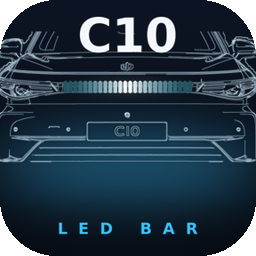

  

<h1 align="center">C10 LED Control</h1>

  <b>by <a href="https://github.com/juanludetoledo">juanludetoledo</a></b> 
  Control the <b>front LED bar of the Leapmotor C10</b> from your phone and <b>Android Auto</b>

  <a href="https://github.com/juanludetoledo/C10-LED-Bar/releases"><b>⬇ Download APK (Releases)</b></a> ·
  <a href="https://github.com/juanludetoledo/C10-LED-Bar/issues"><b>🐞 Report an Issue (GitHub Issues)</b></a> ·
  <a href="https://t.me/juanludetoledo"><b>💬 Telegram</b></a> ·
  <a href="https://www.alibaba.com/x/1lBZ7u1?ck=pdp"><b>🛒 Buy the LED bar</b></a> ·
  <a href="https://ko-fi.com/juanludetoledo"><b>☕ Ko-fi</b></a>

---

## What is C10 LED Control?

**C10 LED Control** is the companion app for the **C10 LED** controller: an ESP32-S3 board that drives the **34-channel front LED bar** of the **Leapmotor C10** over the car's CAN bus. The app talks to the controller over **Bluetooth (BLE)** — switch the bar on and off, set the brightness, run light shows and design your own animations channel by channel.

> [!IMPORTANT]
> **Everything is free and public:** the app, the firmware and the hardware assembly manual.
> If you like the project and want to support it, you can buy me a coffee on **[Ko-fi](https://ko-fi.com/juanludetoledo)**.

### Main Features

- ✅ **Quick control** — ON / OFF, *Remember off state*, and sensor ON / OFF.
- ✅ **Brightness** — real-time slider with a fine 0–1000 scale.
- ✅ **Automatic day / night** — by time or **by sunrise and sunset** at your location.
- ✅ **9 light shows** — Waves, Snake, Stars, Party, Pacific, Breathing, Comet, Cinema and Random tour, plus your own animation.
- ✅ **Parked behaviour** — welcome animation, breathing, ping-pong effects, your own effect list and **motion-sensor** sensitivity (MPU6050).
- ✅ **Animation builder** — 4 slots, basic movements, a 34-channel editor, an emulator and saving to the bar.
- ✅ **Live view** — see what the bar is doing right now.
- ✅ **Android Auto** and **home-screen widget**.
- ✅ **iPhone** — Wi-Fi control page at `192.168.4.1`.
- ✅ **Windows firmware installer** and **firmware updates over Wi-Fi** with a *back to original firmware* safety button.
- ✅ **4 languages** — **Español · English · Português · 中文**.

---

## Build the Hardware

Step-by-step assembly manual (parts list, wiring diagram, connection tables, fitting in the car and troubleshooting):

- 🇪🇸 **Español:** [C10_LED_BAR_Manual_montaje_ES.pdf](docs/hardware/C10_LED_BAR_Manual_montaje_ES.pdf)
- 🇬🇧🇺🇸 **English:** [C10_LED_BAR_Assembly_manual_EN.pdf](docs/hardware/C10_LED_BAR_Assembly_manual_EN.pdf)
- 🇵🇹🇧🇷 **Português:** [C10_LED_BAR_Manual_montagem_PT.pdf](docs/hardware/C10_LED_BAR_Manual_montagem_PT.pdf)
- 🇨🇳 **中文:** [C10_LED_BAR_Assembly_manual_ZH.pdf](docs/hardware/C10_LED_BAR_Assembly_manual_ZH.pdf)

🛒 **Where to buy the LED bar:** [Alibaba](https://www.alibaba.com/x/1lBZ7u1?ck=pdp) — **ask the seller to send the bar's connector too** (6-pin connector, 4 used: **pin 1** +12 V and **pin 2** GND to the fuse tap and ground; **pin 5** CAN-H and **pin 4** CAN-L to the SN65HVD230 CAN transceiver). Wire colours can vary by seller — always follow the pin number. Full pinout with photo on **page 4** of the assembly manual.

🔧 **Fitting the bar:** remove the 4 upper screws, take out the original bar and fit the new one. The new bar is not plugged into the car's harness: its connector goes to the C10 LED controller.

**Firmware:** flash it onto the ESP32-S3 with the **Windows installer** (`.exe`) from [Releases](https://github.com/juanludetoledo/C10-LED-Bar/releases). Ask for the installer key in a private message on **[Telegram @juanludetoledo](https://t.me/juanludetoledo)**.

> [!WARNING]
> **How to choose the right ESP32 (very important):**
> - Board: **ESP32-S3-DevKitC-1**, with **N16R8** printed on the metal module (16 MB flash + 8 MB PSRAM).
> - It must be an **ESP32-S3**: it has **Wi-Fi and Bluetooth (BLE)** built in. An ESP32-P4, H2, C6 or any board without Wi-Fi and Bluetooth **will not work**.
> - Module **WROOM-1** (built-in antenna), **not WROOM-1U** (that one needs an external antenna).
> - **Two USB-C ports** on the board.
> - If the listing does not say **ESP32-S3** and **N16R8**, do not buy it.

Parts: ESP32-S3-DevKitC-1 **N16R8 (16 MB)**, SN65HVD230 CAN transceiver, MPU6050 motion sensor, 12 V → 5 V USB-C converter, fuse tap (fuse FF41, 10 A), sealed box and dupont wires.

---

## User Manuals

Step-by-step guide: installation, connecting to the bar, every tab, the animation builder, Android Auto, iPhone and troubleshooting:

- 🇪🇸 **Español:** [MANUAL.md](MANUAL.md)
- 🇬🇧🇺🇸 **English:** [MANUAL.en.md](MANUAL.en.md)
- 🇵🇹🇧🇷 **Português:** [MANUAL.pt.md](MANUAL.pt.md)
- 🇨🇳 **中文:** [MANUAL.zh.md](MANUAL.zh.md)

---

## Report Bugs & Feedback (GitHub Issues)

Found a bug or have an idea? Please open an issue in the **GitHub Issues** tab:

👉 **[https://github.com/juanludetoledo/C10-LED-Bar/issues](https://github.com/juanludetoledo/C10-LED-Bar/issues)**

*(You can write in Spanish, English, Portuguese or Chinese. Including your phone model, app version and sketch version — shown in **System → Information** — helps fix issues much faster.)*

For installation help: **Telegram [@juanludetoledo](https://t.me/juanludetoledo)**.

---

## Support the Project

**C10 LED Control** is free, public and ad-free. If it makes your C10 shine and you'd like to buy me a coffee:

- ☕ **Ko-fi:** [https://ko-fi.com/juanludetoledo](https://ko-fi.com/juanludetoledo)

You can also follow the project as **@juanludetoledo** on YouTube, TikTok, Instagram and Facebook.

Thank you! ❤️

---

## License & Legal

- **Free for non-commercial use.** You may use, copy, modify and share this project for free, crediting **juanludetoledo**. **Selling it, or any part of it, is not allowed.** See [LICENSE](LICENSE) and [PRIVACY.md](PRIVACY.md).
- Android Auto is a trademark of Google LLC. Independent community project, not affiliated with Leapmotor or Google.
